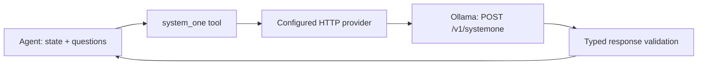

# Existing retrieval and classification integrations

This deployment note covers F1 and F2 of the adaptive-retrieval specification using existing components: an externally maintained `ask-rag-engine` skill and the installed `pi-system-one` extension. Neither is bundled or reimplemented by Overpowered. The harness maps functional retrieval/classification requests to these components when available. `know-enough` remains the portable knowledge policy; the existing structured-data skill keeps responsibility for exact data queries.

## Implementation scope and changes to existing skills

The implementation adds instructions for reusing the existing components, deployment guidance, and compatibility tests. The HTTP connections are provided by the external retrieval skill and `pi-system-one`. The actual Pi installation was not configured or exercised during this repository work.

| Component | Change made for F1/F2 |
|---|---|
| [`know-enough/SKILL.md`](../skills/know-enough/SKILL.md) | Unchanged: it already directs the agent to the adaptive-retrieval procedure and delegates selection of available means to the harness. |
| [`know-enough/references/adaptive-retrieval.md`](../skills/know-enough/references/adaptive-retrieval.md#handoff-to-existing-retrieval-and-classification-capabilities) | Added handoff rules for existing retrieval and classification capabilities, interpretation of results, and fallback behavior. |
| [`using-overpowered/SKILL.md`](../skills/using-overpowered/SKILL.md) | Unchanged: its reuse-before-creation rule already maps functional acquisition plans to available skills/tools/services. |
| [`know-enough/evals/evals.json`](../skills/know-enough/evals/evals.json) | Added cases 13–17 covering cited retrieval syntheses, independent classification questions, unavailable or ambiguous classification, malformed results, and avoiding unnecessary calls. |

Execution follows the Agent Skills model: the agent reads these instructions, inspects the skills/tools available in its harness, and chooses appropriate calls. There is no new programmatic router that binds `semantic_search` to `ask-rag-engine` or `classification` to `system_one`, and no new registration mechanism. The main skill already links to the modified reference, so the added rules become available when the agent follows its existing reading instructions.

Deployment-specific names and API details live in this adapter note. The normative knowledge policy continues to request abstract capabilities, allowing another environment to supply different implementations. The npm packaging pattern was also corrected to include the contents of skill references, so the updated instructions are delivered with the package.

## F1: reuse the installed `ask-rag-engine`

Read the installed skill to obtain its endpoint, authentication, supported operations, and response contract. Keep those settings and secrets outside this repository. Do not assume a standard RAG API or infer hybrid/reranking support from the service name.

The supplied implementation uses a chat-completions request with `stream: false`, one focused natural-language question per call, and a document code when known. Its answer is in `choices[0].message.content`; references appear inside that text. Preserve the full answer and citations rather than trying to read an invented `passages` or `documents` field. Its documented model-availability probe confirms service reachability and model presence, not source authority or corpus coverage.

Distinguish a cited synthesis from an inspected original passage. Carry the document/page references into the knowledge state, request the original source through available means when required, and leave missing version, date, identifiers, and authority explicit. A reported absence of information or an inaccessible service must not become a fabricated answer. Use the deployed engine's hybrid search/reranking if its actual contract exposes them; do not add guessed flags or implement a second reranker.

In practice, when documentary acquisition is needed, the agent selects the discoverable external skill, reads its instructions, follows its documented call procedure, and evaluates the returned evidence using `know-enough`. The supplied RAG implementation was not modified or copied into Overpowered. Its installation and visibility remain the responsibility of the harness's existing skill-discovery mechanism.

## F2: reuse `pi-system-one`

Source review: [`pi-system-one` 1.3.4, commit `17be72d`](https://github.com/iamaamir/system-one/tree/17be72d3595532a79ff68070dd69720a7631e108/pi-system-one), checked on 2026-10-13. This identifies the reviewed upstream implementation, not the version installed in a particular environment.

The extension registers the `system_one` tool, contributes its `system-one` skill and `/judge` prompt, and resolves configuration and credentials itself. Its agent input is `state` plus named `questions`. The configured HTTP provider adds the deployment's model and sends `POST /v1/systemone`. Keep model selection in the extension configuration: adding a top-level `model` to tool arguments does not select it in this version.

The existing core validates typed answers and distributions. The tool exposes results in `structuredContent` and `details` (`answers`, `model`, `usage`, `requestId`, `metadata`) as well as rendered text. Preserve the returned question IDs, probabilities, confidence, and score legend. Noul is a probability of true, with no separate confidence field; score may be fractional. Neither is evidence that retrieval is sufficient. The extension's general guidance for bounded judgments does not make classification necessary for every knowledge request: keep Overpowered's proportionality and fallback rules.

The new generic handoff instructions ask the agent to check deployment suitability and authorization, formulate the bounded judgment, retain its typed results, and fall back to its own reasoning when classification is unavailable, invalid, or ambiguous. They rely on the selected capability's existing validation and introduce no universal probability thresholds.

For example, structured filtering and conceptual retrieval can both be useful. The agent can send these independent questions to `system_one`:

```json
{
  "state": {
    "request": "Find facilities able to test above 80 degrees C and with experience of similar tests."
  },
  "questions": {
    "has_structured_filters": {
      "type": "noul",
      "instructions": "Does the request contain explicit structured filters?"
    },
    "needs_semantic_retrieval": {
      "type": "noul",
      "instructions": "Does the request require conceptual comparison with test reports?"
    }
  }
}
```

Both probabilities can be high; their sum need not equal one. The results can inform a composite acquisition plan, but qualifying facilities still require evidence from exact records and reports. Classification remains optional when the active model can already choose an adequate strategy.

The following execution chain is supplied by the existing extension:



### Ollama serving Cloudflare Clef-Flash

[Ollama's Clef-Flash entry](https://ollama.com/library/clef-flash) documents support from Ollama 0.35.1 and the HTTP model name `clef-flash`. Use the exact local model tag if the installation renamed it; the Hugging Face identifier `Cloudflare/clef-flash` is not automatically an Ollama model tag. Confirm the running server version, model availability, and a typed response; downloaded weights alone do not establish serving compatibility.

For an existing installation, select **custom** in `/so config`, set the Ollama base URL and local model tag, then inspect `/so status`. A saved configuration in `<agent-dir>/pi-system-one.json` can look like:

```json
{
  "mode": "custom",
  "baseUrl": "http://127.0.0.1:11434",
  "model": "clef-flash",
  "timeoutMs": 60000
}
```

The base URL excludes `/v1` and `/v1/systemone`: the provider appends the full route. The timeout above is an example budget allowing model loading, not a measured latency guarantee. `<agent-dir>` is normally `~/.pi/agent`, or the directory selected by `PI_CODING_AGENT_DIR`. Restart/reload other running clients after changing the saved configuration.

Alternatively, when no mode is saved, configure the process that launches Pi:

```bash
export SYSTEM_ONE_BASE_URL=http://127.0.0.1:11434
export SYSTEM_ONE_MODEL=clef-flash
export SYSTEM_ONE_TIMEOUT_MS=60000
```

Use `SYSTEM_ONE_API_KEY` only if the endpoint needs authentication; never put it in saved JSON. A saved mode/endpoint takes precedence over an environment endpoint. An environment model/key is tied to its matching endpoint; `/so status` reports when the environment endpoint is ignored. Existing TypeSafe login credentials are not forwarded to a custom origin.

For this local deployment, use `custom`: `auto` can route to Pi's TypeSafe classifier or TypeSafe HTTP, and `native` uses Pi's registered TypeSafe classifier and rejects Score in the reviewed version. The reasoning fallback belongs to the harness; it is not permission to switch to a remote classifier. If local classification is disabled for the task, unavailable, incompatible, or ambiguous, skip the tool and reason from the available evidence.

The reviewed provider sends text/JSON `state`, `questions`, and `model`. It does not forward top-level `images` or `keep_alive`, even though Ollama exposes them. The retrieval-routing use case needs only text/JSON. A successful chat endpoint or an installed model is not a substitute for a successful SystemOne request.

### Verification

Use [the integration checks](../tests/knowledge-integrations/README.md) for repeatable tests against the external implementation and a smoke procedure in the actual harness. The fixtures are synthetic; they do not call production services. `/so debug` helps confirm the actual selected provider and target in Pi.

Implementation evidence: [configuration](https://github.com/iamaamir/system-one/blob/17be72d3595532a79ff68070dd69720a7631e108/pi-system-one/src/config.ts), [provider selection](https://github.com/iamaamir/system-one/blob/17be72d3595532a79ff68070dd69720a7631e108/pi-system-one/src/provider.ts), [tool input/output](https://github.com/iamaamir/system-one/blob/17be72d3595532a79ff68070dd69720a7631e108/pi-system-one/src/tool.ts), [HTTP transport](https://github.com/iamaamir/system-one/blob/17be72d3595532a79ff68070dd69720a7631e108/system-one-core/src/providers/http.ts), and [Ollama's decision API](https://docs.ollama.com/capabilities/decision).

## Activation and recorded verification status

For these instructions to take effect, the deployment must load the updated `know-enough` skill and its reference, discover the external RAG skill, and expose `system_one` with the intended configuration. Existing installed copies of Overpowered need the updated files. This adapter Markdown file documents the connection; it does not configure Pi, register tools, or activate services by itself.

Repository verification on 2026-10-13 established:

- **14 compatibility tests passed** against the reviewed external source. The tests import its real configuration, provider selection, transport, validation, and rendering code, while replacing HTTP responses with synthetic fixtures. They do not exercise a running Pi session or live Ollama inference.
- **Five behavioral scenarios were added** to the existing skill evals. They describe expected agent behavior and have not been executed in Pi.
- **The suite validator passed for 18 skills**, and the npm package dry run confirmed inclusion of the updated references and integration artifacts. The auxiliary skill-creator validator rejected the pre-existing `compatibility` frontmatter field, with the same rejection reproduced against the unchanged baseline.
- **Live deployment verification remains outstanding**: actual skill/tool discovery, effective configuration, RAG source access, and an Ollama/Clef-Flash SystemOne response must be checked in the installed harness using the linked smoke procedure.
